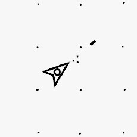
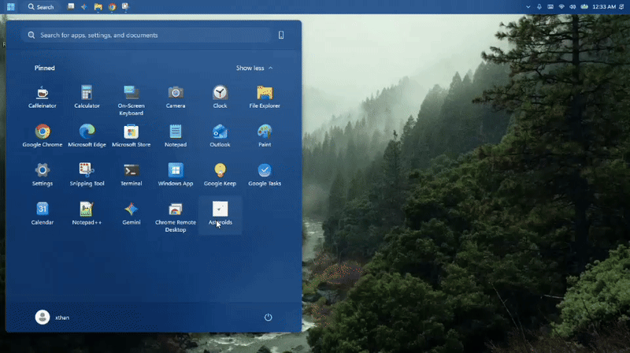

# Asteroids-for-windows
its asteroids for windows exe, it installs into app data so to pin to start you gotta search its name after installation, to uninstall right click and find it in the resulting menu and click uninstall

  

  

# Build instructions:

for android version:  

download android code studio from github and install on android device, open asteroids for android sub folder in ACSProject first subfolder is acs project ACSProject\asteroids or whatever, open that in android code studio wait for configuration to complete and then click play button to build debug apk  

## asteroid for windows build instructions:  

install node js msi standalone installer and install    

get nodes msi *nstaller fr(m website scroll past package manager options its at the bittom msi *nstsller 

cd into npmElecrrons sub fokder that countainsbfilesnto buikd   right 

npm install --save electron  
npm install --save-dev @electron-forge/cli  
npm install --save-dev @electron-forge/maker-squirrel  
npm install --save electron-squirrel-startup  

npm run make

  

pro tip:  if you got no sound you hdmi plugged into monitor w*thout soeskers change s(und to source thag gas soeskerd 
